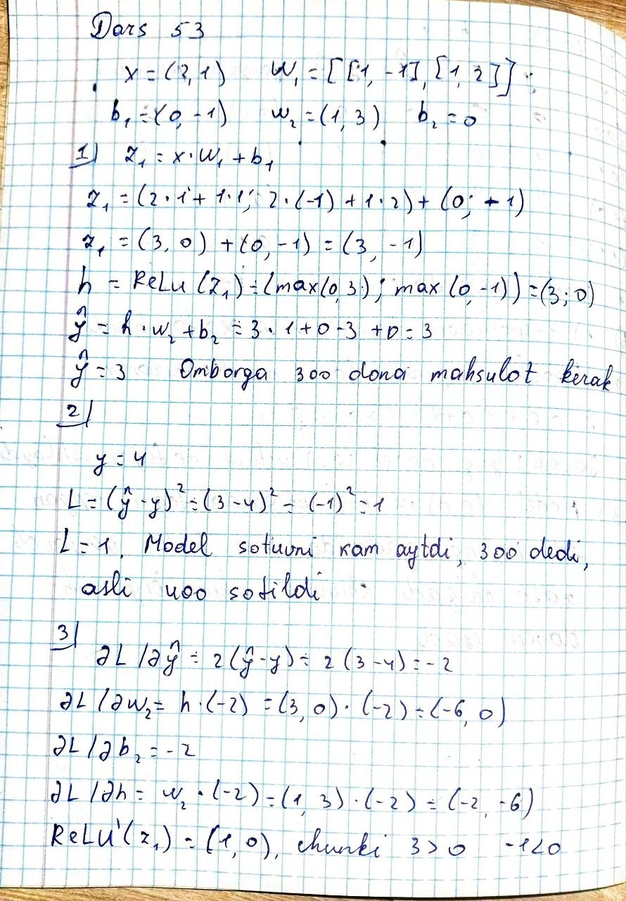
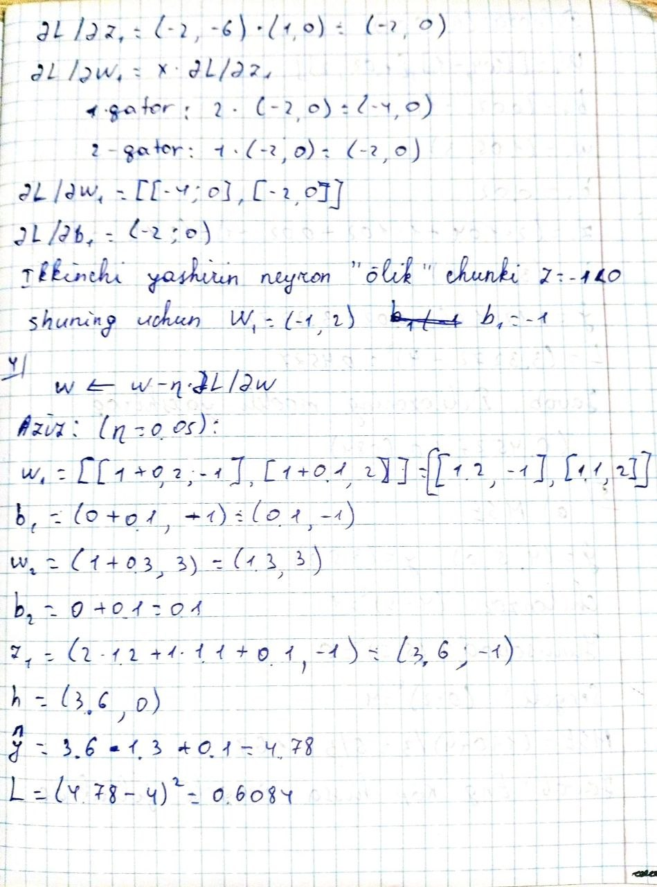
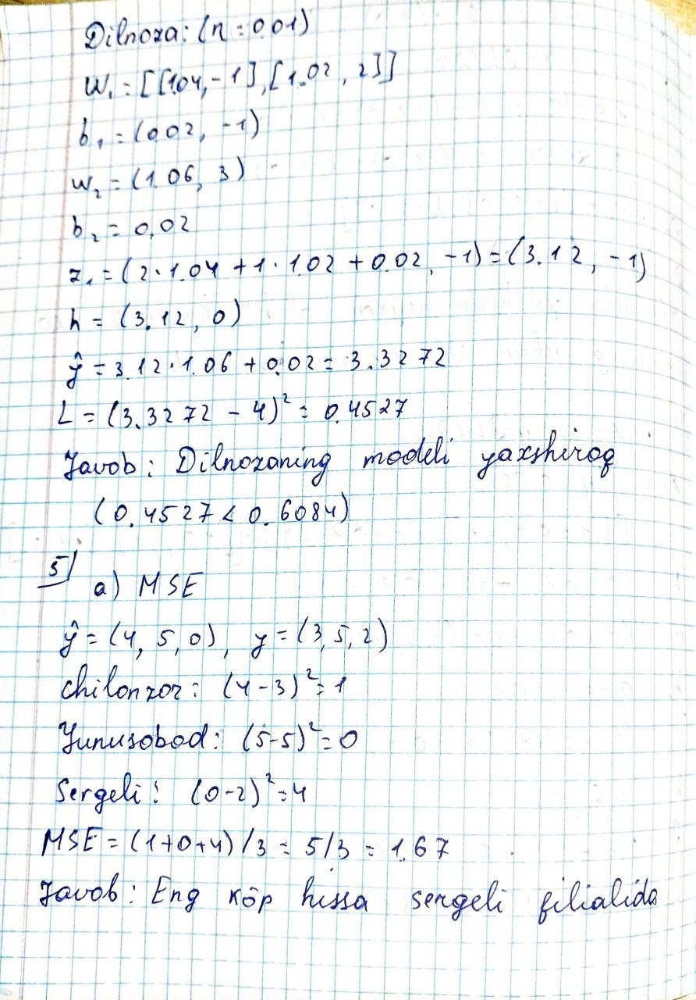
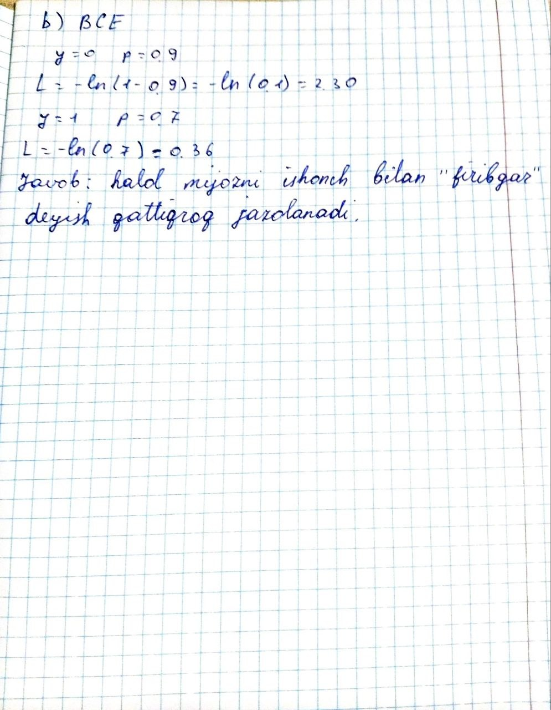

# 🧠 ML Homework 53 — Forward va Backpropagation

Neyron tarmoqning to'rt asosiy qadami bo'yicha uyga vazifa:
**forward → loss → backward → yangilash**. Hisoblar qo'lda, NumPy'da va PyTorch'da bajarilgan.

## 📋 Mundarija

| Qism | Mavzu | Asosiy natija |
|---|---|---|
| 1 | Qo'lda hisob: Korzinka filiali | ŷ = 300 dona, L = 1, gradientlar qo'lda topildi |
| 2 | NumPy: aqlli uy kontrolleri (XOR) | Gradient check farqi ≈ 2.6·10⁻¹¹ |
| 3 | PyTorch: Korzinka va Antarktida | Autograd qo'lda hisob bilan mos, test aniqligi 99.0% |
| 4 | Ishdagi vaziyatlar | 5 ta amaliy savolga javob |
| Bonus | NumPy'da 3 sinfli MLP (4 → 8 → 3) | Test aniqligi 99.0% |

## ✍️ 1-qism. Qo'lda hisob

Korzinka filiali uchun 2 → 2 (ReLU) → 1 tarmoq: forward, MSE loss, backward va ikki xil η bilan yangilash.

| Savol | Javob |
|---|---|
| Bashorat | z₁ = (3, −1), h = (3, 0), ŷ = 3 → **300 dona** |
| Xato | L = (3 − 4)² = **1**, model sotuvni kam aytdi |
| Gradientlar | ∂L/∂W₁ = [[−4, 0], [−2, 0]], ∂L/∂w₂ = (−6, 0). Ikkinchi neyron "o'lik" |
| Ikki stajyor | Aziz (η = 0.05): L = 0.6084 · Dilnoza (η = 0.01): L = 0.4527 → **Dilnoza yaxshiroq** |
| MSE va BCE | MSE = 1.67 (eng ko'p Sergeli) · BCE: 2.30 va 0.36 |

<details>
<summary>📷 Qo'lda yozilgan yechim (rasmlar)</summary>






</details>

## 🔢 2-qism. NumPy: XOR uchun MLP

**2.2 — Learning rate (2000 epoch)**

| lr | Loss | Bashorat | To'g'ri? |
|---|---|---|---|
| 0.1 | 0.6169 | [0 1 0 0] | ❌ |
| 0.5 | 0.0140 | [0 1 1 0] | ✅ |
| 1.0 | 0.0049 | [0 1 1 0] | ✅ |
| 2.0 | 0.0020 | [0 1 1 0] | ✅ |
| 5.0 | 0.0007 | [0 1 1 0] | ✅ |

**2.3 — Yashirin neyronlar:** XOR uchun kamida **2 ta** neyron kerak (n_h = 1 da model OR ga o'xshab qoladi).

**2.4 — ReLU va sigmoid:** ReLU har bir lr da sigmoid'dan past loss berdi (lr = 1.0: 0.0001 va 0.0016).

## 🔥 3-qism. PyTorch

**3.1 — Autograd:** `loss.backward()` qo'lda topilgan gradientlarni aynan takrorladi.

**3.2 — Pingvinlar turini aniqlash (test aniqligi)**

| hid \ lr | 0.01 | 0.1 | 1.0 |
|---|---|---|---|
| 2 | 0.4369 | 0.8155 | 0.9806 |
| 8 | 0.7961 | **0.9903** | 0.9903 |
| 32 | 0.8641 | 0.9903 | 0.9903 |

Tavsiya: **hid = 8, lr = 0.1**. `opt.zero_grad()` o'chirilganda gradientlar yig'ilib boradi va model noto'g'ri o'qitiladi.

## 💼 4-qism. Ishdagi vaziyatlar

Aktivatsiyasiz qatlamlar, o'lik ReLU, forward qiymatlarini saqlash, scaler'ning ahamiyati va `loss = nan` sababi bo'yicha javoblar notebook ichida.

## ⭐ Bonus. PyTorch'siz MLP

Faqat NumPy bilan 4 → 8 (ReLU) → 3 (softmax) tarmoq: loss 1.43 → 0.04, **test aniqligi 0.9903** (talab: > 0.95).

## 🚀 Ishga tushirish

```bash
pip install -r requirements.txt
jupyter notebook ML_Homework_53.ipynb
```

## 🛠 Texnologiyalar

Python · NumPy · PyTorch · scikit-learn · seaborn

---
*Muallif: Muhammadyusuf*
